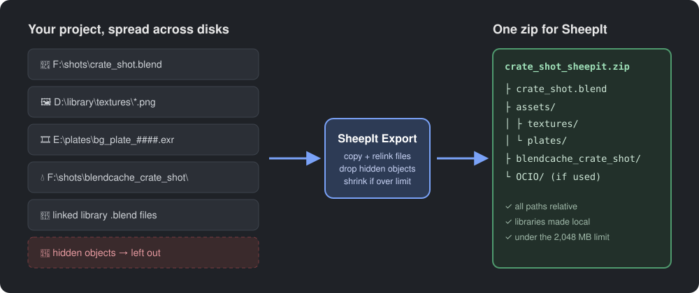
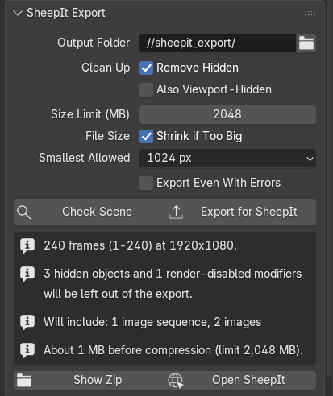
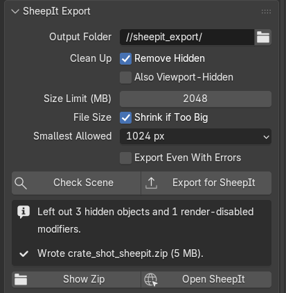

# SheepIt Export

Blender add-on that turns the current scene into a single zip you can upload to the
[SheepIt render farm](https://www.sheepit-renderfarm.com/), with every external file
included and all paths relative.

## Install

Blender 4.2 or newer: **Edit > Preferences > Get Extensions > ⌄ > Install from Disk** and
pick `sheepit_export.zip` from the [latest release](https://github.com/patcrowley/sheepit-export/releases/latest)
(or drag the zip onto the Blender window).

## Use

Properties editor > **Render** tab > **SheepIt Export**.

<table>
<tr>
<td width="50%" valign="top">

<b>1. Check Scene</b> lists problems against SheepIt's rules and shows what will be packed.

</td>
<td width="50%" valign="top">

<b>2. Export for SheepIt</b> builds <code>&lt;name&gt;_sheepit.zip</code> in the output folder
(default <code>//sheepit_export/</code>). It runs in the background; press Esc to cancel.

</td>
</tr>
</table>

**3.** Upload the zip on SheepIt and pick the `.blend` inside it.

Your open file is never modified; the export works on a copy.

## What goes in the zip

- Image textures, UDIM tiles, image sequences and video textures
- Movie clips, VSE image and movie strips, fonts, OpenVDB volumes, Alembic/USD caches,
  IES files
- Baked caches: disk point caches (`blendcache_<name>`), fluid, ocean and Geometry Nodes bakes
- A custom OCIO config (from the `OCIO` environment variable), as `OCIO/config.ocio`
- Linked libraries are made local; unused data is purged

Sounds are left out; they aren't needed for rendering.

## Removing hidden things

With **Remove Hidden** on, the export leaves out:

- Objects with the render (camera) toggle off, and objects in collections that are excluded
  from the view layer or disabled for render
- Modifiers switched off for render
- Anything only those objects used (materials, textures, meshes)

Objects that something visible still depends on are kept: boolean cutters, instanced
collections, particle instances, modifier/constraint/driver targets, parents, rigid-body
members and the scene camera.

**Also Viewport-Hidden** additionally drops objects hidden with the eye or monitor icon.
It's off by default because those objects still render.

## Shrinking when over the limit

The size limit defaults to SheepIt's 2,048 MB. If the zip is bigger and **Shrink if Too Big**
is on, the export downscales image textures and image sequences step by step
(4096 → 2048 → 1024 … down to **Smallest Allowed**), re-zipping after each step until it fits.
Video textures are re-encoded at the same sizes if ffmpeg is available (set its path in the
add-on preferences if it isn't on your PATH).

Not shrunk: VSE strips and movie clips (resizing them would change the render or tracking),
and simulation caches. If caches are what's too big, split the animation into several
projects as described in the SheepIt FAQ.

## Checks

- Render engine (Cycles, EEVEE, Workbench) and matching engines across scenes
- Active camera, video output formats, render region
- EXR rules: allowed codecs, max 4096×2160, animations only
- Python drivers, registered text scripts and OSL (scripts don't run on SheepIt)
- Unbaked simulations, compositor File Output nodes, missing files
- Non-release Blender builds
